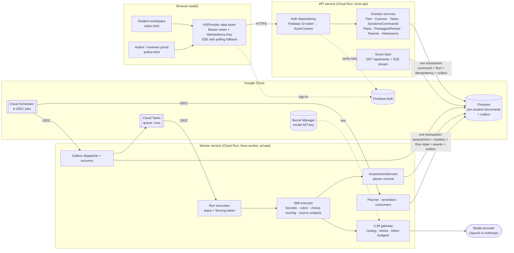
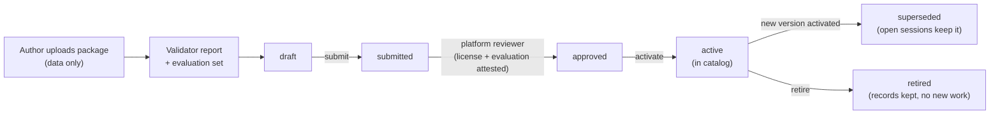

# High School Student OS

An AI-powered **course platform** for US high school students. Each course (AP subjects, test
prep, …) is a **course package**: reviewed *data* (skills, question bank, rubrics, course
requirements, completion and follow-up rules, an evaluation set) that runs on **one shared
runtime**. Calculus BC is the first-party reference course; Digital SAT is rebuilt purely
through the authoring path.

The core loop, per course:

> **learning evidence → student record → next study task → updated weekly plan**
> (the plan spans all enrolled courses; courses never affect each other)

Rules for contributors live in [`CLAUDE.md`](CLAUDE.md); design docs are in [`doc/`](doc/)
(start with [`BACKEND.md`](doc/BACKEND.md), [`API.md`](doc/API.md),
[`COURSE_PACKAGE.md`](doc/COURSE_PACKAGE.md), [`STEP_BY_STEP_PLAN.md`](doc/STEP_BY_STEP_PLAN.md)
and [`OPERATIONS.md`](doc/OPERATIONS.md)).

---

## 1. Architecture



### Components

| Component | Responsibility | Code |
|---|---|---|
| Web workspace | Course catalog, per-course agent (chat, submit, progress), tasks and weekly plan | `web/index.html`, `web/js/` |
| Author portal | Upload packages, see validator/evaluation reports, submit for review, preview, metrics | `web/author.html`, `web/js/portal/` |
| API | Thin FastAPI layer: token verification, Pydantic validation, delegation to domain | `server/app/api/` |
| Domain | All business rules, typed ports, no infrastructure imports | `server/app/domain/` |
| Adapters | Firestore, Firebase Auth, Cloud Tasks, LLM providers, tools (math verification) | `server/app/adapters/` |
| Registries | Course package loading, validation, version pinning, content sync | `server/app/registries/` |
| Worker | Run execution, outbox dispatch, recovery, scheduled planning, reminders, event consumers | `server/app/workers/` |
| Content | Bundled packs, authored packages, evaluation sets, prompts | `server/content/` |
| Fixtures | Synthetic students and platform members only | `server/fixtures/` |

Dependency direction is strict: `api/ → domain/ ← adapters/`, and `workers/ → domain/`.

### Key guarantees

- **No client authority.** The browser sends commands and answers only, never scores, mastery,
  events or tool results. Identity comes only from a verified Firebase ID token.
- **Atomic writes, no external calls inside transactions.** A command writes its record, the
  `QUEUED` Run, the idempotency record and an outbox entry together; an assessment writes the
  assessment, mastery, Run terminal state, events and outbox together.
- **At-least-once delivery, exactly-once effects.** Leases with fencing tokens, idempotency keys
  on every POST, at most one active Run per session, consumer receipts.
- **Courses are data and independent.** Packages are validated and reviewed before `active`;
  each Run pins its package version; evidence in one course never touches another.
- **No fabricated results.** Exam predictions stay `unavailable`; `insufficient_evidence`
  never updates mastery; hint-assisted success is not independent evidence.

---

## 2. Data flow: one learning interaction

```mermaid
sequenceDiagram
    autonumber
    participant S as Student (browser)
    participant A as API
    participant F as Firestore
    participant Q as Cloud Tasks
    participant W as Worker
    participant M as Model provider

    S->>A: POST /api/sessions/{id}/submissions<br/>Bearer token + Idempotency-Key
    A->>F: transaction: Submission + Run(QUEUED)<br/>+ idempotency record + outbox entry
    A-->>S: 202 { runId }
    A->>Q: dispatch outbox entry (also swept every minute by Scheduler)
    Q->>W: POST /internal/runs/execute (OIDC)
    W->>F: transaction: take lease, fencing token+1, Run → RUNNING
    W->>W: load pinned package version, rubric, student context
    W->>M: skill prompt (rubric assessment / Socratic hint)
    M-->>W: structured draft
    W->>W: validate against rubric; math verification tool
    W->>F: transaction (only if token still ours):<br/>Assessment + mastery + Run SUCCEEDED + events + outbox
    F-->>A: new events (per-student monotonic sequence)
    A-->>S: SSE: run.started, assessment.completed, mastery.updated, run.completed
    Note over W,F: Follow-up consumers and the planner react to events<br/>inside the same course; the plan spans all enrolled courses
```

If a worker dies mid-run, its lease expires and the Scheduler-driven recovery job re-queues the
Run; the fencing token stops a stale worker from committing. Choice-set courses (e.g. Digital
SAT) are scored by answer key in the worker with no model call.

### Publishing a course



Students still need a platform-managed entitlement to enroll in an active course.

---

## 3. Run locally

### Prerequisites

| Tool | Needed for |
|---|---|
| Python 3.12+ and [uv](https://docs.astral.sh/uv/) | Backend |
| Python 3 (any) | Serving `web/` |
| Node 18+ | Web tests only (`make test-web`) |
| Firebase CLI + Java 11+ | Only for the emulator option (B) |

```bash
make install          # uv sync in server/
make help             # list all targets
```

Settings are read from environment variables and an optional `server/.env`
(copy [`server/.env.example`](server/.env.example); never commit real keys).

### Option A: in-memory backend (quickest, no Java)

```bash
make server-memory    # terminal 1: API + local worker on :8787, store seeded with fixtures
make web              # terminal 2: static web on :8000
```

Open <http://localhost:8000> and use **local development sign-in** to pick a synthetic
student (`stu_alex` or `stu_beth`). The author portal is at
<http://localhost:8000/author.html> (`author_hsos`, `author_sample`, `reviewer_platform`).
Data is lost when the API stops.

### Option B: Firebase emulators (real Firestore transactions)

```bash
make emulators        # terminal 1: Auth + Firestore emulators (ports from server/firebase.json)
make seed             # terminal 2: seed synthetic students, members and packages
make dev              # terminal 2: API (auto-reload) + web together
```

Then open <http://localhost:8000> as above.

### Option C: demo mode (no backend)

```bash
make web
```

Open <http://localhost:8000/?demo=true>. A DEMO banner is shown; nothing is saved or graded.

### Using a real model locally

By default `HSOS_LLM_PROVIDER=mock`, which returns clearly labeled synthetic replies and never
grades. To call a real model, set in `server/.env`:

```bash
HSOS_LLM_PROVIDER=openai          # or anthropic
OPENAI_API_KEY=...                # or ANTHROPIC_API_KEY=...
```

Model tiers can be overridden with `HSOS_LLM_MODEL_FAST/BALANCED/STRONG`; token budgets with
`HSOS_LLM_*_TOKEN_BUDGET`. Real model calls cost money.

### Tests and checks

```bash
make check            # ruff + mypy (strict) + backend tests + web tests — run before committing
make test-unit        # domain logic and schemas
make test-contract    # API flows over the in-memory store
make test-emulator    # Firestore transactions, isolation, recovery (needs Java)
```

Evaluation tests against a real model are opt-in: `HSOS_RUN_REAL_LLM_SMOKE=1`.

---

## 4. Run on Google Cloud

The deployment is two Cloud Run services built from one image (`server/Dockerfile`; the
service is chosen by `HSOS_ASGI_APP`), plus Firestore, Cloud Tasks, Cloud Scheduler, Secret
Manager, Cloud Storage, and the web app on Firebase Hosting. Use a **dedicated project**; never
share it with other projects. Staging and production refuse to start with emulator hosts, the
mock model, the in-memory store or the local queue.

### Prerequisites

- A Google Cloud project with billing, with Firebase added to it.
- `gcloud` (authenticated: `gcloud auth login` and `gcloud auth application-default login`)
  and the Firebase CLI (`firebase login`).
- In the Firebase console: **Authentication → Sign-in method → Email/Password** enabled, and a
  web app named **`hsos-web`** (`firebase apps:create WEB hsos-web --project $PROJECT_ID`).
- Edit `HSOS_CORS_ALLOWED_ORIGINS` in [`deploy/staging/api.env.yaml`](deploy/staging/api.env.yaml)
  to your Hosting origins (`https://$PROJECT_ID.web.app`, `https://$PROJECT_ID.firebaseapp.com`).

### Step 1: provision and deploy the backend

[`deploy/staging/provision.sh`](deploy/staging/provision.sh) enables APIs, creates Firestore
(with daily backups), service accounts and IAM, the model-key secret, buckets, the `runs` queue,
both Cloud Run services, six Scheduler jobs, log metrics, alert policies and (optionally) a
budget. It is safe to re-run: existing resources are skipped.

```bash
export PROJECT_ID=my-hsos-staging REGION=us-central1
export FIRESTORE_LOCATION=nam5        # optional; defaults to $REGION
export LLM_PROVIDER=openai            # or anthropic (default)
export BILLING_ACCOUNT=XXXXXX-XXXXXX-XXXXXX BUDGET_USD=20   # optional budget alerts

./deploy/staging/provision.sh            # dry run: prints every command
APPLY=1 ./deploy/staging/provision.sh    # executes them
```

The first `APPLY` run stops before the image build because the model key secret is empty.
Add the key (it never passes through the repo), then re-run:

```bash
printf '%s' "$OPENAI_API_KEY" | gcloud secrets versions add openai-api-key \
  --data-file=- --project "$PROJECT_ID"      # anthropic-api-key / $ANTHROPIC_API_KEY for Anthropic
APPLY=1 ./deploy/staging/provision.sh
```

The image tag defaults to the current commit (`git rev-parse --short HEAD`); set `IMAGE_TAG`
to deploy a working tree with uncommitted changes under a distinct tag.

### Step 2: Firestore indexes

```bash
cd server && firebase deploy --only firestore:indexes --project "$PROJECT_ID" && cd ..
```

Real Firestore enforces composite indexes (the emulator and in-memory store do not); skipping
this step makes some queries fail with `FailedPrecondition`.

### Step 3: deploy the web app

```bash
./deploy/staging/deploy_web.sh     # uses PROJECT_ID and REGION
```

This builds a copy of `web/` whose `config.js` points at the deployed API and the `hsos-web`
Firebase config, and deploys it to `https://$PROJECT_ID.web.app`. The repo's `web/config.js`
stays empty.

### Step 4: seed synthetic users (staging only)

```bash
cd server
HSOS_STAGING_TEST_PASSWORD='<choose one, ≥12 chars>' \
  uv run python -m scripts.seed_staging --project "$PROJECT_ID" --confirm "$PROJECT_ID"
```

This creates the synthetic students and platform members (password sign-in) and their
documents. It refuses `demo-*` projects, emulator settings, and any project that already holds a
non-fixture student. Re-running it keeps existing event and planning counters.

### Step 5: verify

```bash
API=$(gcloud run services describe hsos-api --project "$PROJECT_ID" --region "$REGION" --format 'value(status.url)')
curl -s -o /dev/null -w "%{http_code}\n" "$API/api/health"             # 200
curl -s -o /dev/null -w "%{http_code}\n" "$API/api/courses/enrolled"   # 401 without a token
```

The worker is private (`--no-allow-unauthenticated`, internal ingress): only the Cloud Tasks /
Scheduler invoker identity can call it. Then sign in at `https://$PROJECT_ID.web.app` as a
synthetic student and run a learning loop. The full staging checklist (Step 32) and the record
of past runs are in [`doc/OPERATIONS.md`](doc/OPERATIONS.md) §5.

### Updating a deployment

Re-run `APPLY=1 ./deploy/staging/provision.sh` (builds and rolls both services) and, if the
frontend changed, `./deploy/staging/deploy_web.sh`. Expect a short window after a rollover in
which a few requests can get a front-end 5xx; commands are idempotent, so retrying is safe.

### Before real students

Staging uses synthetic data only. Real students require the pre-production checklist in
[`CLAUDE.md`](CLAUDE.md) §7.3 and the pilot gate (Step 33 in
[`doc/STEP_BY_STEP_PLAN.md`](doc/STEP_BY_STEP_PLAN.md)): reviewed course content, a reviewed
evaluation set, a real reminder channel, and production config with
`HSOS_REQUIRE_REVIEWED_CONTENT=true`.
