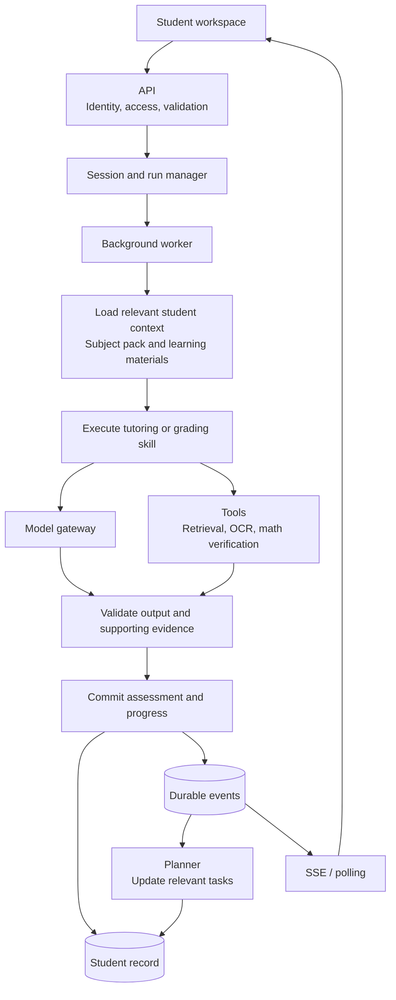

# High School Student OS — Architecture Recommendations

Date: 2026-10-29

## Review scope and recommendation

**The agent, session, tool, and event concepts discussed are a good foundation for your High School Student OS.** Your documents already apply many of them. The strongest product idea is the connection between **learning evidence → student record → next study task → updated weekly plan**.

This review covers the six documents under `hs-os/doc`, including the detailed implementation steps. It is a design review; the current application implementation has not been verified. No LOGIQ code was copied. The recommendations use general architectural concepts and technologies, not LOGIQ implementation details.

These are proposed revisions, not replacements for the existing confirmed design decisions until adopted.

## 1. Keep your existing product architecture

The structure in [HIGH_SCHOOL_STUDENT_OS.md](HIGH_SCHOOL_STUDENT_OS.md) is appropriate:

| General agent-platform concept | Student OS equivalent |
|---|---|
| Configured agent | AP tutor, SAT tutor, admissions coach |
| Instructions and tools | Subject packs, tutoring skills, rubrics, calculators |
| Persistent context | Academic Digital Twin |
| Task orchestration | Master Planner |
| Session | A tutoring conversation or practice activity |
| Execution events | Feedback ready, assessment completed, plan updated |
| Artifacts | Student answers, annotated feedback, essay outlines |
| Scheduled workflows | Daily planning and weekly progress summaries |

Use these as general architectural patterns. You do **not** need LOGIQ’s code, API format, server, or an Anthropic-compatible public API. Define an API around your student workflows.

Your three agents can initially be **configurations running through one shared runtime**. They do not require three services or autonomous agents talking to one another.

## 2. Build this backend pipeline

For example:

1. A student opens a Calculus task.
2. The backend loads the task, relevant mastery evidence, and Calculus pack.
3. The student submits an answer.
4. A worker evaluates the answer using the rubric and appropriate tools.
5. The backend saves the assessment and updates the student record.
6. A verified prerequisite weakness may generate a short SAT diagnostic.
7. The planner fits that task into the student’s available time.
8. The interface explains what changed and why.

This gives students a concrete reason to return: each completed activity improves the next recommendation.

## 3. Revise the task/session model before implementation

[API.md](API.md), section 1.3, currently treats Task and Session as two states of the same record. Separate three concepts:

| Entity | Meaning | Example |
|---|---|---|
| Task | Planned learning objective | Practice function composition |
| Session | Student’s ongoing work on that objective | Conversation, answers, attachments |
| Run | One backend execution | Evaluate one submitted answer |

A session can contain several runs. A task can support multiple attempts.

This handles normal student behavior: closing a browser, returning tomorrow, asking another question, correcting an answer, or retrying a failed upload.

Persist sessions and runs. The in-memory session map proposed in [STEP_BY_STEP_PLAN.md](STEP_BY_STEP_PLAN.md), Step 16, would otherwise lose active sessions on restart.

## 4. Strengthen the learning-data contract

This is the most important change.

[API.md](API.md), section 2.6, currently allows a client request containing `scoreDelta: 0.3`, and the detailed plan adds that value to the predicted AP score.

For real students, the browser should submit **answers and evidence references**. The server should calculate assessment results.

Store an assessment with:

- The submitted answer and question version.
- Rubric version and supporting evidence.
- Whether hints were used.
- Assessed skills and uncertainty.
- Model and grading-workflow versions.

Then derive mastery from those records.

Separate **practice performance**, **estimated mastery**, and **predicted exam score**. One corrected answer should not automatically move an AP prediction from 4.5 to 4.8. Until predictions have been calibrated against independent assessments, show skill progress and evidence coverage.

For cross-domain recommendations, use the same discipline: an implicit-differentiation error does not automatically prove a SAT function-composition weakness. A curated mapping can identify a possible prerequisite issue; a short diagnostic can confirm it.

Likewise, an internal AP estimate should not automatically change a student’s admissions category.

## 5. Make backend state changes reliable and authoritative

Your shared `commitSettlement()` boundary is a useful design. Extend it so the assessment, progress update, completion status, and outgoing event are saved together.

Recommended behavior:

- Repeating the same submission returns the existing result.
- Restarting a worker does not apply mastery gains twice.
- Replaying an event does not create duplicate SAT tasks.
- A browser disconnect does not cancel accepted work.
- Events carry `studentId`, `sessionId`, `runId`, sequence, and schema version.

Keep client commands separate from authoritative events. Students can submit answers; only the backend should emit events such as `assessment.completed` or `mastery.updated`.

There is also a specific access issue in [API.md](API.md), section 2.2: students can currently patch `subscriptions`. Separate student course preferences from access entitlements, which should be controlled by the backend.

## 6. Adapt the technology stack to this project

**Updated 2026-10-30:** Backend switched to Python. The earlier recommendation for Node.js is superseded.

These are the current technology choices:

| Area | Recommendation |
|---|---|
| Backend | Python 3.12+, FastAPI, uvicorn |
| Validation | Pydantic v2 models, shared across API and domain |
| Structure | Modular monolith; same codebase can run API and worker processes |
| Student data | Dedicated Student OS Firestore database, matching your planned direction |
| Local development | Firestore emulator; JSON fixtures for demos |
| Background jobs | Cloud Tasks with persisted run state and idempotent handlers |
| Scheduled planning | Cloud Scheduler, using each student’s timezone |
| Files | Cloud Storage |
| Live updates | SSE with replay; polling as fallback |
| Authentication | Student OS identity provider with stable user IDs |
| Model access | Your existing `LLMGateway` abstraction |
| Deployment | Cloud Run |
| Observability | Structured logs, run latency, model usage, assessment failures |

Use a stable `studentId` internally; retain email as a profile field or integration mapping. Authentication should work independently of the reference applications.

For longer workflows with complicated approval and recovery requirements, consider Temporal later. You do not need it to validate the first tutoring workflow.

MCP is also optional initially. A small internal tool interface can support retrieval and math verification; add MCP adapters when interoperability provides a concrete benefit.

## 7. Narrow the first release and change milestone priorities

Your implementation plan already favors complete vertical slices. Narrow the first slice further:

> **One Calculus practice session → evidence-based feedback → saved progress → relevant SAT follow-up → revised daily plan.**

Deliver it in this order:

1. **Reliable foundation:** identity, student isolation, persistent sessions/runs, and validated submissions.
2. **One useful tutoring experience:** Calculus feedback with reviewed questions and rubrics.
3. **One cross-domain connection:** verified prerequisite weakness produces a SAT task.
4. **Proactive planning:** deadlines, available hours, reminders, and student-controlled rescheduling.
5. **Broader coverage:** APUSH, admissions interviews, and additional subject packs.

Move authentication and student isolation earlier than M5—before any external student pilot. Define parent access separately: a progress summary need not expose private tutoring conversations or essay drafts.

Keep Jev optional. Your documents describe it as an external decision service, but those vendor claims have not been independently verified in this review. Static model routing and measured evaluations are sufficient to start.

Make the first release’s acceptance criteria about **learning quality and reliability**: accurate feedback on reviewed examples, appropriate follow-up tasks, recovery after restart, no duplicate progress updates, and students understanding why their plan changed. Those results will tell you more about the product’s value than the number of agents or subject packs.

## Documents reviewed

- [HIGH_SCHOOL_STUDENT_OS.md](HIGH_SCHOOL_STUDENT_OS.md)
- [BACKEND.md](BACKEND.md)
- [API.md](API.md)
- [IMPLEMENTATION_PLAN.md](IMPLEMENTATION_PLAN.md)
- [STEP_BY_STEP_PLAN.md](STEP_BY_STEP_PLAN.md)
- [COMPETITIVE_REVIEW.md](COMPETITIVE_REVIEW.md)
