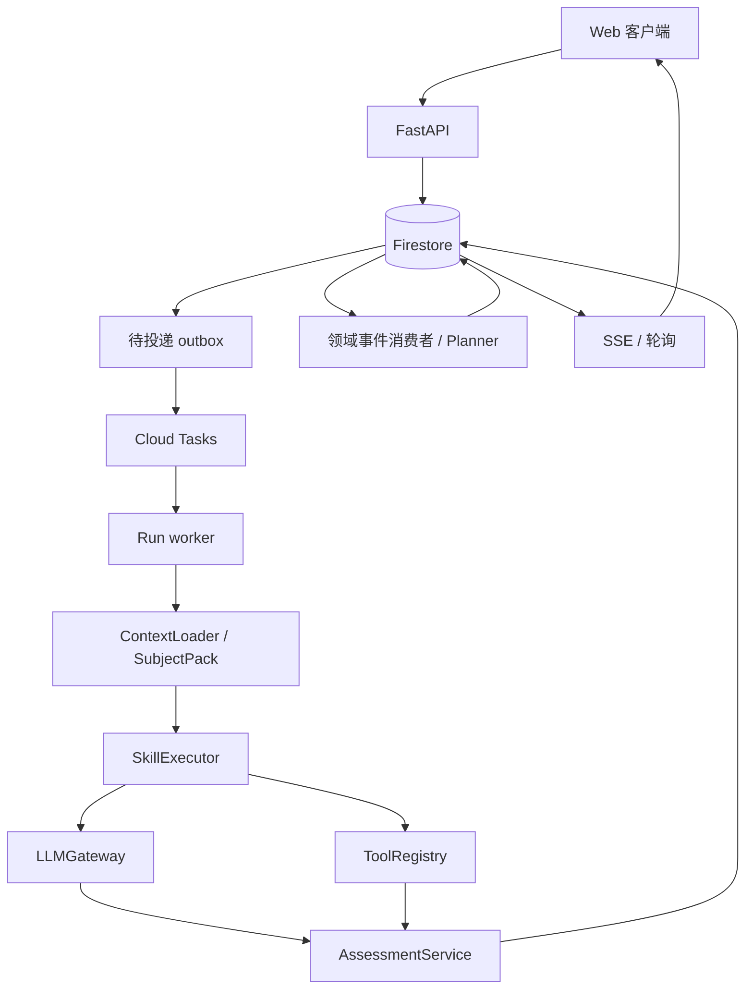

# High School Student OS — 后端设计 v0.4

更新：2026-10-30。增加课程注册数据模型（§3）、对话上下文装载策略（§5.4）、SubjectPack manifest 与 system prompt（§7.1）。采纳 [架构建议](STUDENT_OS_ARCHITECTURE_RECOMMENDATIONS.md)，替代 v0.2 的单文件 HTTP、JSON 生产存储、email 主键、内存 Session 和强制 Jev 依赖。本文件是目标设计，不是已实现能力清单。产品边界见 [HIGH_SCHOOL_STUDENT_OS.md](HIGH_SCHOOL_STUDENT_OS.md)，接口以 [API.md](API.md) v0.3 为准。

## 1. 形态与技术栈

一个模块化单体代码库，API 和 worker 可作为两个进程/Cloud Run 服务部署，复用领域模块。首版不用三个 Agent 微服务、不自建通用工作流语言，也不兼容 LOGIQ API；不复制 LOGIQ 代码。

| 职责 | 选型 |
|---|---|
| API / 类型 / 校验 | Python 3.12+、FastAPI、Pydantic v2、mypy |
| 身份 | Student OS 自有 Firebase Authentication 项目；验证 token 并映射稳定 studentId |
| 事务数据 | Student OS 自有 Firestore；本地 Firestore emulator |
| 作业调度 | Cloud Tasks；本地持久 outbox + 可重复投递的队列适配器 |
| 定时触发 | Cloud Scheduler；按学生 IANA 时区判断到期工作 |
| 文件 | Cloud Storage；本地隔离文件适配器用于测试 |
| 客户端更新 | 持久事件 + SSE，轮询作为基础和回退 |
| 模型 / 工具 | LLMGateway、静态 ModelRouter、内部 ToolRegistry |
| 部署 / 观测 | Cloud Run、结构化日志、OpenTelemetry 兼容埋点与用量统计 |

JSON 文件仅用于种子与离线演示。生产不依赖本地磁盘持久性。MCP、Jev 和 Temporal 暂不进入必需依赖。



## 2. 身份、权限与所有权

- 验证 Firebase ID token 的签名、issuer、audience、有效期；使用经验证的 subject 映射 studentId。生产拒绝 emulator token 与调用者自行声明的用户头。
- 每个存储与领域函数显式接收 `ActorContext`，包含 actorId、studentId、权限范围。客户端不能靠 body 中的 studentId 选择他人身份。
- email 是可变联系方式，不用于主键、文件路径或共享 JWT 密钥。未来参考产品账号通过独立映射和授权协议接入。
- 学生可改 profile、goals、preferences 的叶字段白名单；`entitlements` 仅管理员配置。学生勾选一门课程不等于获准使用。
- Task、Session、Run、Submission、Assessment、事件、文件与检索均校验归属。跨学生 ID 查询返回 404，避免暴露存在性。
- 家长不是学生会话的别名。后续 `summary:read` 授权只返回摘要投影，默认不含作答/对话/文书。API 校验授权关系，不能只靠前端隐藏。
- 服务端 Firestore Admin SDK 绕过客户端规则，故 API/worker 仍必须做归属检查；浏览器不直接读写权威学习数据。

## 3. 数据模型与持久化

Twin 是统一逻辑视图，不是存放四年历史的一个巨大 JSON 文档。建议布局：

```text
students/{studentId}                         # profile/goals/preferences/version
students/{studentId}/access/current          # entitlements，后台写
students/{studentId}/enrollments/{courseId}   # 学生主动注册的课程；status/enrolledAt/unenrolledAt
students/{studentId}/tasks/{taskId}
students/{studentId}/sessions/{sessionId}
students/{studentId}/messages/{messageId}
students/{studentId}/runs/{runId}
students/{studentId}/submissions/{submissionId}
students/{studentId}/assessments/{assessmentId}
students/{studentId}/mastery/{skillId}
students/{studentId}/files/{fileId}
students/{studentId}/events/{eventId}
students/{studentId}/eventState/current       # nextSequence
students/{studentId}/idempotency/{keyHash}
students/{studentId}/outbox/{deliveryId}
students/{studentId}/consumerReceipts/{receiptId}
students/{studentId}/plans/{planId}
students/{studentId}/examRecords/{recordId}
students/{studentId}/predictions/{predictionId}
students/{studentId}/runInputs/{inputRequestId}   # M1：WAITING_INPUT 的类型化回复（如 OCR 核对）
identities/{uid}                                  # M1：已验证 uid → studentId，仅服务端读写
```

M1 实现说明：仓储写在 `DocTxn` 接缝上（读穿透事务、写缓冲至提交，同一事务内可读到自己的缓冲写），生产后端为 Firestore SDK，测试/无 Java 本地开发使用内存后端（部署环境拒绝）。唯一性约束依赖文档而非查询：Task 文档的 `openSessionId` 保证一 Task 一 OPEN Session，Session 文档的 `activeRunId` 保证一 Session 一非终态 Run，`eventState/current` 保证事件序号连续，注册文档被 Session/命令事务读取以与取消注册互斥。

M2 实现说明：新增 `usage/{run-<id>|session-<id>|day-<UTC 日期>}`（预算计数与在途预留，预留超时失效）与 `toolResults/{id}`（工具账本，只存状态和输出，不存输入）。`mastery/{skillId}` 保存投影结果及其证据贡献列表（键为 evidence application id `{assessmentId}:{skillId}`，因此同一证据只应用一次，重评替换贡献，可由评估重建）。Assessment ID 由 Run 确定（`asm_{runId}`），重放提交返回已有结果。Submission 在接受时冻结服务端事实：此前提示次数 `serverHintCount` 与同题先前尝试次数 `priorAttemptCount`。

M3 实现说明：新增 `consumerReceipts/{consumer}:{eventId}:{target}`、`consumerState/{consumer}`（消费者已处理的事件序号）、`plans/{planId}` 与 `planState/current`（当前 PLANNING Run 与最新计划）。outbox 条目增加 `kind`（`run` / `consumers`）；旧文档缺省为 `run`。

按 studentId、状态、到期时间等实际查询建立索引。后台 outbox collection-group 查询仅服务身份可用；客户端不得用全局查询绕过学生边界。题目、rubric 与技能都属于各自的课程包，是独立版本化内容目录；课程之间不互相引用（2026-11-01 起不再有跨课程技能映射）。

| 数据 | 规则 |
|---|---|
| Enrollment | 学生主动注册记录；注册前校验 entitlement + availability；取消注册保留历史，不删除 mastery/assessment |
| Submission | 不可变作答版本；修改建立新提交，引用之前版本 |
| Assessment | 引用题目/rubric/提示/工具/模型/工作流版本；可重评为新版本 |
| Mastery | 由 accepted assessment 投影；同一证据只应用一次，可从证据重建 |
| Prediction | 与 mastery 分开；校准模型、评估数据、适用范围俱全后才开放 |
| File | DB 存元数据和权限，正文在对象存储；有上传/校验状态 |
| Run | 持久执行状态、尝试次数、租约/fencing token、使用量和输出引用 |
| Event | per-student 单调 sequence、schemaVersion、因果引用和脱敏 payload |

`GET /api/twin` 返回有界摘要和分页资源引用，避免把全部历史塞入模型或单个响应。学生材料采用保留/删除策略；删除时清理对象、检索索引与派生缓存，并记录备份到期处理方式。

## 4. Task / Session / Run 状态机

- Task：`PLANNED → IN_PROGRESS → COMPLETED`；未开始任务可 `SKIPPED`。进行中的任务跳过前须关闭 Session 并取消未完成 Run。
- Session：`OPEN → COMPLETED / ABANDONED`。一个 Task 可多次尝试，首版同一 Task 最多一个 OPEN Session。
- Run：`QUEUED → RUNNING → SUCCEEDED / FAILED / CANCELLED`；需要核对 OCR 等输入时 `RUNNING → WAITING_INPUT → QUEUED`，只接受对应 inputRequestId 的类型化输入。
- 默认同一 Session 仅一个非终态 Run；并发新命令返回 `409 RUN_IN_PROGRESS`，同幂等键重试先返回已有 Run。
- PLANNING Run 是学生范围的后台执行，可令 sessionId=null；按计划版本和来源键控制并发，不占学习 Session 的执行位置。
- worker 可在租约过期后重试同一 Run；终态不重新执行。任务队列确认与 Run 状态分别管理，不假设消息只投递一次。
- 模型完成一条提示是 SUCCEEDED，不是学生任务完成。`complete` 命令依据保存的 accepted assessment 和任务要求关闭 Session/Task；`abandon` 不声称完成。

## 5. 请求、队列与恢复

### 5.1 接受命令

API 在一个 Firestore 事务中写命令/提交、Run(QUEUED)、幂等记录和 outbox。事务内不调用模型、队列或外部工具。成功后立即返回 202 和 Run ID。

幂等键按 actor/student + 路由作用域 + key + 规范化请求摘要检查。同 key 同请求返回原结果；同 key 不同请求返回 409。原结果 ID/摘要至少保留到关联 Session/Task 数据删除，响应缓存可独立过期。

### 5.2 Outbox 投递

提交后可立即尝试派发，另有定时扫描补偿。dispatcher 使用确定 deliveryId 派发 Cloud Tasks，标记已投递；在“已入队、尚未标记”窗口崩溃会重复投递，worker 仍须去重。不能以 Cloud Tasks 的任务名去重时限作为永久业务保障。

### 5.3 Worker 执行

1. 验证队列 OIDC 调用身份与 audience；普通学生 token 无权调用 worker。
2. 事务获取 Run 租约并增加 fencing token；已完成则直接确认。
3. 装载固定内容/工作流版本与最小学生上下文；检查权限、token/工具预算。**验证课程注册状态**——未注册课程的 Run 写 FAILED。
4. 执行短的可恢复步骤，保存输出引用和工具账本；长流程切成多次任务，遵守 Cloud Tasks/Cloud Run 的请求期限。
5. 提交时再次比较租约 token、状态和版本；旧 worker 不能覆盖新尝试或取消结果。
6. 有限重试和退避；不可重试错误写 FAILED 与面向学生的恢复说明。租约超时扫描可重新入队；不依赖某个 API 进程持续存活。

浏览器断开不取消 Run。取消为持久命令；工具调用前与提交前检查取消状态。对外写操作后续若引入，需工具级幂等键/结果查询；不承诺能撤销已经完成的外部副作用。

### 5.4 对话上下文装载（ContextLoader）

Worker 在步骤 3 中使用 ContextLoader 组装 LLM 调用的完整上下文。每个 Run 的模型输入由以下部分构成：

**System Prompt 组装顺序：**

1. **SubjectPack system prompt** — 来自 `content/packs/{courseId}/system_prompt.md`，定义该课程 agent 的角色、教学风格和行为边界。
2. **Skill 指令** — 当前 Run 使用的 skill（如 `socratic-guidance` 或 `rubric-assessment`）追加的任务级指令。
3. **学生上下文摘要** — 当前 mastery 状态、目标、偏好、活跃任务的简要描述，由 ContextLoader 从 Twin 数据投影。
4. **题目/rubric 内容** — 当前 Session 活跃的题目及评分标准（仅评估 Run）。

**对话历史加载策略：**

| 策略 | 规则 |
|---|---|
| Session 内消息 | 加载当前 Session 的全部持久化消息（学生消息 + agent 回复），按时间正序 |
| 上下文窗口限制 | 总 token 预算由 SubjectPack manifest 的 `contextBudgetTokens` 配置（默认 8000）；超出时从最早消息开始截断，保留最近的对话和当前题目上下文 |
| 跨 Session 记忆 | 首版不自动加载历史 Session 的消息；同一课程的 mastery 状态已作为学生上下文摘要传递，提供间接的跨 Session 连续性 |
| 提示记录 | 每次 HINT Run 的回复记录在 messages 中，后续 ASSESS Run 可见该 Session 内的提示历史，用于评估 hintUsage |

ContextLoader 不加载其他课程的 Session 消息，也不加载其他课程的 mastery。课程彼此独立，不把一门课程的对话或掌握度注入另一门课程 agent 的 prompt。

**Agent 回复持久化：** Worker 生成的回复作为 message 写入 `students/{studentId}/messages/{messageId}`，关联 sessionId 和 runId，后续对话加载时与学生消息合并排序。

## 6. AssessmentService 与学习更新

`commitAssessment(actor, runId, validatedAssessment, fencingToken)` 是唯一评估提交边界。替代任意 `commitSettlement(delta)` 写入方式。

验证题目归属与版本、rubric 范围、证据引用、学生原始答案、工具结果与提示记录；JSON Schema 合法仅代表格式正确。模型无法提供可靠依据时结果为 `insufficient_evidence`，可展示有限反馈，但不写掌握度。

一次事务保存 assessment、对应 mastery 投影、Run 终态、必要事件及 outbox，并记录 evidence application ID。重复执行返回已有结果。重新评分使用 supersedesAssessmentId，替换该证据贡献并重建受影响投影，而不是追加同一题的分数。连续订正/提示后成功不当作独立无提示测量。

`completeSession()` 另在事务中检查无活跃 Run、满足完成规则，写 Session/Task 完成状态及事件。它只总结已有评估，不再次增加 mastery。前端无权传 score delta、accepted 状态或工具成功证明。

考试预测首版固定 unavailable；经过独立校准后另由 PredictionService 发布。禁止“修正一步 → AP 预测加 0.3”的产品逻辑。

## 7. 内容、模型与工具

Registry 加载版本化 manifest（agent、pack、skill），只启用已验证内容。第一方参考课程包 calc_bc；Digital SAT（dsat）是独立课程、M3 第二门课程候选（选择题按答案键评分）；Admissions 保持 planned。Run 固定 pack/skill/rubric/workflow 版本，升级不改变正在运行的行为。

### 7.1 SubjectPack manifest 与 system prompt

每个课程包的目录结构：

```text
content/packs/{courseId}/
  manifest.json            # 课程元数据、能力声明、模型配置
  system_prompt.md         # 该课程 agent 的 system prompt 模板
  questions/               # 题目库
  rubrics/                 # 评分标准
  skills/                  # 技能定义与前置关系
```

manifest.json 示例：

```json
{
  "courseId": "calc_bc",
  "name": "AP Calculus BC",
  "version": "1.0.0",
  "availability": "active",
  "agentType": "AP_BASE",
  "supportedTaskTypes": ["SOCRATIC_STUDY", "FRQ_PRACTICE"],
  "supportedModes": ["GPA_SYNC", "EXAM_CRUNCH"],
  "skills": ["socratic-guidance", "rubric-assessment"],
  "tools": ["math-verify", "content-retrieval"],
  "modelTier": "balanced",
  "contextBudgetTokens": 8000,
  "systemPromptPath": "system_prompt.md"
}
```

`system_prompt.md` 用 Markdown 编写，支持变量插值（`{{studentName}}`、`{{currentMode}}`、`{{masteryContext}}`），ContextLoader 在运行时填充。system prompt 定义该课程 agent 的教学风格、回应规则和安全边界，不包含学生私有数据 —— 学生上下文由 ContextLoader 在组装时动态注入。

不同课程的 system prompt 可差异显著：Calculus agent 强调推导过程和数学严谨性，APUSH agent 侧重文献分析和论证结构。agent 之间不共享 system prompt，但共享运行时引擎和安全规则。

M2 实现说明：路由 = max(pack `modelTier`, skill 下限)；rubric-assessment 下限为 strong，socratic-guidance 为 fast。提供方由 `HSOS_LLM_PROVIDER` 选择（`anthropic` 或 `openai`，同一 `LlmProvider` 接口；一次部署只用一个提供方，不做跨提供方回退）。默认 fast/balanced/strong：Anthropic 为 `claude-haiku-5-5` / `claude-sonnet-5-5` / `claude-opus-5-5`，OpenAI 为 `gpt-5.4-mini` / `gpt-5.4` / `gpt-5.5`（`HSOS_LLM_MODEL_*` 可覆盖）。OpenAI 走 Responses API，strict JSON schema，`store=false`，拒答与 `content_filter` 都映射为 `MODEL_REFUSED`。两个 SDK 自身重试都关闭，由网关统一重试并计费；不启用服务端拒答回退（回退会用未评估的模型作答或评分），拒答直接 `MODEL_REFUSED`。结构化输出用 JSON schema；网关再用 skill 的解析函数校验，失败计入重试。生产环境要求 `HSOS_REQUIRE_REVIEWED_CONTENT=true`，未审阅的题目/rubric/材料不会被加载。math-verify 用 SymPy，输入先做字符/标识符白名单（`parse_expr` 会执行代码），超时或缺依赖返回 unavailable，模型与校验器不一致时评估降为 insufficient_evidence。

`LLMGateway` 封装厂商 SDK，输入为受控 system/context/messages/schema，输出包含内容、usage 与模型版本。路由先用 manifest 的 fast/balanced/strong 和规则升级；不需要 decision 模型。

每个 Run/Session 及学生每日有预算；失败重试也计费。达到上限时暂停/拒绝新执行并解释原因；只有通过同一评估门槛的替代模型才能降档，不能为省钱静默降低评分质量。schema 重试有限，最终无效输出不得提交 accepted assessment。

ToolRegistry 使用 `execute(name, input, context)`，服务端白名单、参数 schema、文件/学生范围约束。首版选必要的检索与数学校验；OCR 在文本闭环后加入。工具失败/模拟结果不冒充真实核验。MCP 以后包装已存在的工具边界。

RAG v1 可从审阅的版本化小语料做确定性检索，记录材料 ID、页/段、课程、授权与哈希。检索前过滤 studentId/courseId/ACL，索引不足时返回材料不足。后续语义检索是否采用向量索引由检索评估决定，不强制单独向量库。

Jev 仅为 M5 后的 DecisionService 实验选项；接入前核验供应商实际接口、可用性、价格与效果。没有 Jev 所有核心流程可用。复杂持久审批需求出现后再评估 Temporal；首版 workflow 使用类型化代码，无通用 JSON 执行器。

## 8. 事件、消费者与实时连接

每个学生的事件在事务中分配递增 sequence；eventId 为不透明标识。客户端通过该学生的 after sequence 获取有序增量，不能用他人的 cursor 读取他人事件。

持久事件是权威记录，进程 pub/sub 只作唤醒优化。UI 读取经过过滤的领域事件投影，不暴露完整工具参数、模型推理过程、凭证或私有文书正文。内部 outbox 与运营日志不直接作为学生事件流。

每个消费者用 `(consumerName, eventId, targetSkill)` 收据；创建目标任务与写收据在同一事务中。事件至少投递一次；失败可重放，不用“恰好一次传输”作保证。消费者只在事件所属的课程内产生效果；课程内后续规则（Step 24.2）由课程包以数据声明，一次错误不等于确认弱点。

SSE 从持久存储补发 after/Last-Event-ID 之后事件，再继续获取增量；所有实例都能恢复，不依赖接到同一进程。带心跳，在部署请求时限前主动结束并让客户端重连。浏览器以支持 Bearer header 的 fetch streaming 连接；不要把 token 放 URL。轮询使用相同序列与去重逻辑。过期 cursor 返回 410，客户端重新读取状态快照再订阅。

M3 实现说明：`EventPublisher` 追加事件；若有已注册的消费者订阅该事件类型，就在**同一事务**中写一条 `kind=consumers` 的 outbox 唤醒（`wake.{eventId}`）。派发器像派发 Run 一样把唤醒投递到 worker 的 `/internal/consumers/process`。消费者按注册顺序运行，每个事务最多处理一个订阅事件：效果 + 收据 + 偏移量一起提交。唤醒派发后长时间未完成的，由恢复扫描（`/internal/runs/recover`）补发新的唤醒。2026-11-01 移除了 Calc→SAT 的三个跨课程消费者（prerequisite-mapper、diagnostic-scheduler、reinforcement-scheduler）；目前生产环境没有注册任何消费者，因此不会写唤醒。基础设施由测试专用消费者验证（崩溃、重复唤醒、全量重放、丢失唤醒、学生隔离），课程内后续规则在 Step 24.2 接入。

## 9. Planner、调度与提醒

Planner v1 按期限、证据不足的技能、学生偏好和每周小时分配所有已注册课程的任务。每个候选有来源与可解释规则版本；保留进行中、已完成和学生锁定安排。

M3 实现说明：`POST /api/plans/replan` 建 PLANNING Run；worker 取得租约后在**一个提交事务**中读取状态、计算计划（planner-rules-v1，纯函数，不调用模型）、写回改期的任务（version+1）、计划文档、`plan.updated` 与 Run 终态。提交失败时租约过期后由恢复扫描重试。计划不新建任务；将来课程内消费者新建的任务用同一容量规则（`place_new_task`）放在本周最早有空的一天，否则顺延到下周。时区按学生 IANA timezone 计算"今天"。

Cloud Scheduler 定期触发 dispatcher，查询 dueAt，按学生 IANA timezone 计算本地日期和下一次执行。`studentId + localDate + planningReason/sourceEvent` 做业务去重；覆盖夏令时、旅行改时区和并发结算。GET tasks 不隐式重新生成。

提醒使用 outbox，按渠道/任务/时段去重，发送前再检查同意、撤销、安静时段与频控。首版无外部写工具，提醒是受控后台服务；不由模型任意发送消息。家长摘要为后续角色化能力。

## 10. 目录、验证与部署

```text
server/
  app/api/               # FastAPI routers/auth dependencies/Pydantic schemas
  app/domain/            # twin/tasks/sessions/runs/assessments/planner
  app/workers/           # run worker/outbox/consumers/scheduler
  app/adapters/          # firestore/auth/queue/storage/llm/tools
  app/registries/        # validated manifests and versions
  app/schemas/           # Pydantic v2 models for API/domain contracts
  content/               # reviewed course packs (questions/rubrics/skills) + evaluation
  fixtures/              # synthetic data only
  tests/                 # unit/contract/emulator/e2e/evaluation
web/                     # existing frontend boundary, adapted to API
```

目标命令与步骤见 [STEP_BY_STEP_PLAN.md](STEP_BY_STEP_PLAN.md)。本地配置显式指定 emulator；生产配置检测到 mock provider/emulator host 应拒绝启动。环境示例只记录变量名与占位值，密钥使用 Secret Manager。

最小验证：跨学生访问、越权字段、重复提交、outbox 两种崩溃窗口、worker 租约竞争、取消与提交竞态、评估提交故障回滚、消费者重放去重、SSE 漏事件恢复、没有证据时不增加 mastery。生产还需 Cloud Tasks OIDC、超时、SSE 重连与备份恢复的 staging 检查。

日志记录 actor/run ID、模型档、耗时、tokens、重试和错误码，不记录原始作答/文书/token。备份包含数据库与文件引用恢复，定期实际演练；模拟环境通过不等于云环境配置已验证。

## 11. 迁移与当前决策

旧设计中的 `X-User-Email`、email 主键、客户端 outcome 加分、公开事件写入口、Task/Session 合并均已废弃。开发者应按 [API.md](API.md) 的迁移表同时调整前后端。

现有 Alex 演示数据保持 synthetic；4.5/4.8 等未校准预测不得迁入真实学生事实。若存在需保留的旧数据，先盘点、备份并版本化导入；不自动信任或静默覆盖。M0 核对实际代码状态，本次文档更新不执行数据迁移或部署。
