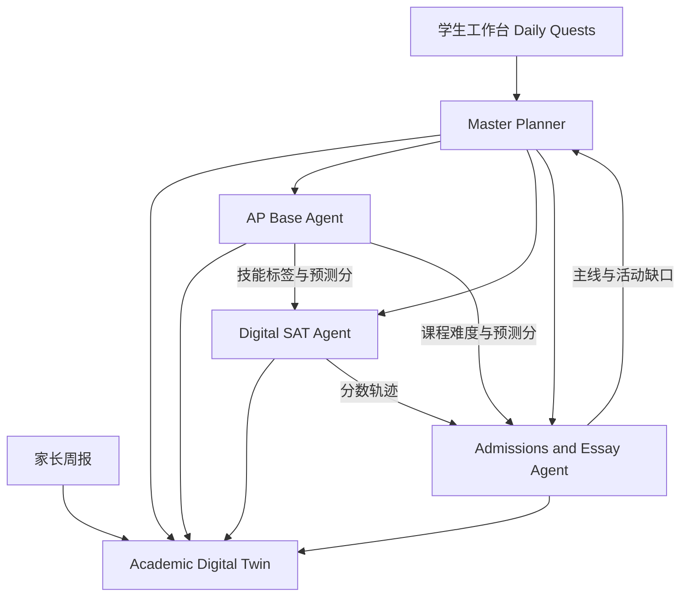
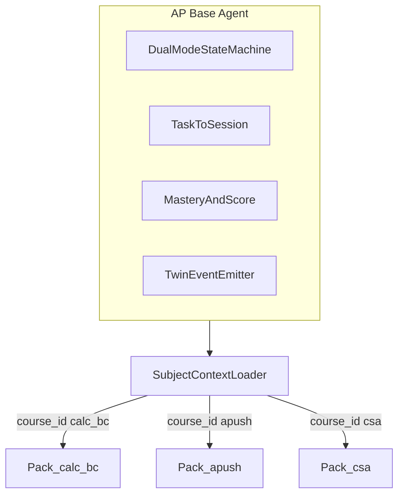

# 高中学业全周期 AI 智能体 — 产品与架构方案

一个面向美国高中生的主动式多智能体系统，覆盖 **AP 学习、Digital SAT 备考、大学申请**。产品中心不是三个工具并列，而是一条贯穿 9–12 年级的学生上下文：画像、目标、日历、掌握度、申请材料互相读写，规划随进度改写。

技术面试不在本产品范围内。`tech-interview-ai/` 不接入。

## 1. 为什么做（相对竞品）

市面产品大多单点突破，或重人力、轻日常学业数据。

| 类型 | 代表 | 缺口 |
|---|---|---|
| 备考与学科 | Khanmigo、Bluebook、Fiveable、Albert.io | 苏格拉底辅导或题库强，但不连到申请列表与文书主线 |
| 校内流程 | Scoir、Naviance、MaiaLearning | 学校端流程工具，几乎无个性化辅导 |
| 申请顾问 | CollegeVine、Kollegio、ESAI | 匹配或文书 brainstorm 可用，与 AP/SAT 提分过程脱节 |

差异化只有两件事，而且必须做成数据契约，不能做成文案：

1. **跨域上下文。** AP Calculus 的薄弱点写入 SAT 数学的练习标签；AP 选课难度与预测分改写 Reach / Match / Safety；SAT 词汇从正在读的 AP English / AP History 材料里出闪卡。
2. **主动规划。** 按 9–12 年级日历推任务、改当周负荷、生成练习与文书大纲。学生不来问，系统也会安排下一小时。

## 2. 架构：1 个中枢 + 3 个垂直 Agent



| 层 | 职责 |
|---|---|
| Academic Digital Twin | 四年的唯一学生记录：画像、目标、日历、掌握度、文书与活动版本 |
| Master Planner | 读 Twin，按截止日期与投入产出分配本周任务，并主动推送 |
| 三个 Agent | 只做本域的专业工作，把结果写回 Twin，不各自保存第二份身份 |
| 体验 | 学生端看今日任务；家长端看趋势与节点。申请季才展开文书工作台 |

现有代码的对应关系：

| 模块 | 决策 |
|---|---|
| Twin + Planner + 今日任务 | 新建。这是产品本体 |
| Admissions Agent | 复用 `ai-college-advisor` 的 profile、选校、文书、申请追踪、roadmap。补上动态选校、活动列表改写、访谈式文书 |
| Digital SAT Agent | 复用 `sat-tutor-app` 的练习、错题本、学习计划。先改成 Digital SAT 1600 与模块自适应，再把错因标签写入 Twin |
| AP Base Agent | 新建一个底座。38 门 AP 不各写一个 Agent。科目差异放进 Skill / RAG / MCP 包，由 `course_id` 热插拔。分数写回 `academic.apScores` |
| 登录 | 以 college advisor 的 JWT 为准，email 为 `userProfiles/{email}` 连接键 |

## 3. 中枢：学术数字孪生与 Master Planner

Twin 在现有 `userProfiles` 上扩展，而不是另起一套用户表。

| 记录 | 内容 |
|---|---|
| Live Profile | 年级、学校、GPA、在修/已修 AP、SAT 模考轨迹、活动与奖项、目标专业、目标学校 |
| Goals | 带日期的目标：SAT 分数与考次、本年 AP 科目与目标分、EA/ED/RD 名单 |
| Master Timeline | 申请截止、SAT 日期、5 月 AP、校内期中期末、每周可用小时 |
| Mastery | 分技能的掌握度、错因标签、预测分 |
| Artifacts | 文书大纲与草稿、150 字符活动描述、选校矩阵版本 |

Planner 选下一小时的规则：

1. 算差距：SAT 当前分 vs 目标；每个 AP 单元 vs 5 月大考；每项申请材料 vs 截止日。
2. 按紧急程度和录取杠杆加权。11 月 EA 文书优先于低杠杆词汇；5 月 AP 只掌握 20% 时，优先于打磨已经完成的 Common App。
3. 装进当周小时。校内 AP 模考周自动降低 SAT 刷题量。
4. 任务必须具体：例如「15 道 SAT 代数线性方程组」然后「打开 UCLA supplement 大纲」，而不是「去学 SAT」。

**ROI 推演**放在 Planner 里，作为建议而不是录取承诺。例：SAT 1510 再花 50 小时冲 1550，对比把 AP Physics C 从 4 提到 5，或补上夏校项目。输出是小时分配建议，并标明依据来自当前画像与公开录取数据，不是录取概率保证。

年级只改变默认配比，不改变架构：

| 年级 | 默认重心 |
|---|---|
| 9 | AP 负荷探索、SAT 基础技能、活动起步 |
| 10 | 课程挑战度、PSAT/SAT 基础、暑假项目 |
| 11 | SAT 峰值、AP 大考、选校、文书启动 |
| 12 | 申请截止优先于新内容 |

## 4. 跨域上下文（必须先定义的数据流）

这是壁垒。每个 Agent 只通过 Twin 上的事件交换信息。

| 事件 | 写入方 | 读取方 | 效果 |
|---|---|---|---|
| `skill.weak` | AP Agent | SAT Agent | AP Calculus 薄弱单元映射到 SAT Math 标签，生成变式题 |
| `course.rigor` + `ap.predicted` | AP Agent | Admissions Agent | 课程挑战度与预测分变化时，重算 Reach / Match / Safety |
| `sat.trajectory` | SAT Agent | Admissions Agent | 模考轨迹更新选校矩阵与专业匹配说明 |
| `vocab.context` | AP English / History 阅读 | SAT Agent | 用正在读的材料生成语境闪卡，而不是孤立词表 |
| `calendar.pressure` | Timeline | Planner | 校内考试周下调 SAT 题量，考前 8 周把 AP 切到真题模式 |
| `narrative.gap` | Admissions Agent | Planner | 主线缺口变成活动或选课任务，例如「申 AI 伦理但缺少人文活动」 |

## 5. 三个垂直 Agent

### AP Base Agent：一个底座，按科目热插拔

AP 是多科目内容包，不是多个产品。若每门 AP 一个 Agent，38 门课会变成 38 套会话、状态机和 Twin 回写。采用 **一个 AP Base Agent + 按 `course_id` 注入的学科包**。学生从 Calculus BC 切到 AP US History 时，会话生命周期、双模式状态机、掌握度计算和 Twin 事件是同一套代码。

界面原型已按这个契约做在 `hs-student-os/index.html`：左侧只有 Digital SAT、AP Base、Admissions 三个入口；AP 下面是已订阅科目胶囊和该科目的任务；中栏顶部的装备栏随科目和模式换装。



Base Agent 是空壳运行时，只负责控制流。学科知识、批改动作和工具由当前 Session 的 `course_id` 决定挂哪一包。

#### 留在底座里（写一次，全科目复用）

| 内核 | 做什么 |
|---|---|
| 订阅校验 | 读 `Twin.subscriptions.apCourses`。未订阅的 `course_id` 不能开 Session |
| 双模式状态机 | `GPA_SYNC`（日常苏格拉底）与 `EXAM_CRUNCH`（考前约 8 周的限时精批）。`calendar.pressure` 可以建议切模式，学生仍可手动切换 |
| Syllabus 管线 | 统一上传入口。把校内课表解析成时间轴，再和该包的考纲树对齐 |
| Session 结算 | 任何科目完成 Task 后，由底座算掌握度增量、更新 `academic.apScores` 预测分，并发 `skill.weak` / `ap.predicted` / `vocab.context` |
| 掌握度 | 目标模型是 Bayesian Knowledge Tracing，输出 1–5 预测分。Phase 1 可以先用错因计数加分项规则，接口仍放在底座，不放进单个科目包 |

#### 放进 Skill 的学科能力（按家族复用，不按 38 门课复制）

Skill 是结构化提示模板、输入输出 JSON Schema，和多步工作流。约 8–10 个核心 Skill，覆盖四类：STEM、史社科、语言写作、计算机。苏格拉底引导全科目共用，用科目参数换提示。

| Skill | 适用 | 执行 |
|---|---|---|
| `skill.frq.stem_derivation_grader` | Calc BC、Physics C | 对手写 OCR 转成的公式，按列式、过程、答案与单位逐行核验，指出漏掉的链式法则或矢量方向 |
| `skill.frq.dbq_rubric_grader` | APUSH、AP Euro、AP World | 按 7 分结构核验 Thesis、Contextualization、Evidence、Outside Evidence、Sourcing、Complexity，对未得分项给改写建议 |
| `skill.frq.rhetoric_essay_grader` | AP Lang | Synthesis / Rhetorical Analysis / Argument，按 Thesis、Evidence and Commentary、Sophistication 给反馈 |
| `skill.frq.java_code_grader` | AP CSA | 区分扣分错误（越界、改了方法签名）和免扣分小瑕疵（漏分号）。不按普通 IDE 规则因一个分号判 0 分 |
| `skill.tutor.socratic_step` | 全科目，按包参数化 | 拦住直接要答案的请求。理科给公式变形提示，文科给史料反问。Tier 2 提示由学生展开 |
| `skill.cross.vocab_extractor` | APUSH、AP Lang | 从正在读的材料里抽出词，连同原句发 `vocab.context` 给 Digital SAT |
| `skill.vision.ocr_latex` | STEM 包 | 手写推导转成可核验的公式，再交给 grader 或 SymPy |

一个 Task 只挂该任务需要的 1–2 个 Skill。日常模式挂苏格拉底；冲刺模式挂对应家族的 FRQ grader。其余 Skill 在装备栏里显示为休眠。

#### 按科目隔离的 RAG（1 门课 = 1 个 namespace）

不收录受版权保护的真题全文。每个 namespace 只放考纲结构和采分逻辑：

| 存储 | 内容 |
|---|---|
| `ced_knowledge_graph` | 该科单元与技能树。Calc BC 等数学相关节点带 `sat_math_mapping_tag`，供 `skill.weak` 联动 SAT |
| `scoring_guidelines_schema` | 采分逻辑和常见失分陷阱。结构对齐公开的评分要点，不复制指南或真题全文 |
| `student_syllabus_chunks` | 该学生上传的本校讲义和笔记。只在 `user_{email}_{courseId}` 这个私有 namespace 里检索 |

MCP 也按包声明，不写进底座：理科挂 SymPy，数学可再挂 Desmos，CSA 挂 Java 沙箱，史地和 Lang 挂 SAT 闪卡桥。Phase 1 的 Desmos 与代码沙箱可以先是演示级，契约先按包注册。

首批五门包：`calc_bc`、`phys_c`、`csa`、`apush`、`ap_lang`。其后每加一门只加 manifest 和 RAG namespace，不新写 Agent。

选课顾问仍是 Admissions / Planner 的任务：结合本校开课、目标专业和当前负荷，建议下一学年挂哪些包。底座只负责已订阅包的学习会话。

#### Task = Session

Planner 里的一条任务对应一次 Session。后端只有一个入口：

```typescript
// POST /api/ap/session/start
interface StartAPSessionRequest {
  userEmail: string;
  taskId: string; // task_20261027_calc_u4_frq
  courseId: "calc_bc" | "phys_c" | "csa" | "apush" | "ap_lang";
  taskType: "SOCRATIC_STUDY" | "FRQ_PRACTICE" | "VARIANT_DRILL";
}

async function initializeAPSession(req: StartAPSessionRequest) {
  const twin = await TwinStore.get(req.userEmail);
  if (!twin.subscriptions.apCourses.includes(req.courseId)) {
    throw new ForbiddenError("Course is not subscribed.");
  }
  const pack = await SubjectPackRegistry.load(req.courseId);
  const courseState = twin.apState[req.courseId];
  return new BaseAPAgentSession({
    sessionId: generateUUID(),
    mode: courseState.currentMode, // GPA_SYNC or EXAM_CRUNCH
    activeSkills: pack.getSkillsForTask(req.taskType),
    ragNamespaces: [
      pack.officialCedNamespace,
      `user_${req.userEmail}_${req.courseId}`,
    ],
    mcpTools: pack.mcpServers,
    studentMasteryContext: courseState.weakSkills,
  });
}
```

结算走底座的 commit hook，不走科目私有的写回路径。前端点击任务即打开这个 Session；装备栏展示本次实际挂上的 Skill、RAG 和 MCP。

### Digital SAT Agent

机考的关键是 Module 2 难度跳变、阅读逻辑，以及 Desmos。

- **自适应模考。** 复刻 Bluebook 的两阶段模块逻辑（Module 1 决定 Module 2 难度）。按错因标签生成同逻辑、同难度的变式题。
- **错因图谱。** 记录的是认知原因，例如「双篇科学文里混淆作者假设与实验结论」，或「Module 2 最后 5 题因时间不够正确率下降」，而不是只统计题型错误率。
- **Desmos 教练。** 代数/函数题同时给代数解法，并演示如何用 Desmos 在短时间内作图求解。
- **语境词汇。** 词表与 AP English / AP History 阅读绑定，生成闪卡和每日微测。

`sat-tutor-app` 今天的计分接近旧 SAT 三科 2400，聊天界面未接模型。在对用户展示「官方样」分数之前，必须改成 Digital SAT 1600 的 Reading & Writing + Math。

### Admissions and Essay Agent

痛点是信息差、人设同质化，以及一键生成文书被招生官识别。

- **选校矩阵。** 用 Common Data Set、公开录取画像，以及学生实时 AP/SAT，维护 Reach / Match / Safety，并给出 Why Major。系统不编造截止日期和未在申请列表里的分数。
- **Narrative / Spike。** 从 AP 选课、活动和经历里提出至多 3 条连贯主线，并指出缺口。
- **访谈式文书，不代写。** Agent 用连续提问收集细节、情绪和转折，产出大纲和素材切片。学生自己写正文。之后按招生官视角给真诚度、反思深度、成长的反馈，并协助把超长草稿压到 Common App 650 词。不提供一键成文。
- **活动列表。** 在 150 字符内用动作动词和可核对的结果重写描述。学生确认事实后再保存。

`ai-college-advisor` 已有 profile、选校、文书反馈、申请追踪和 roadmap。缺的是动态矩阵、主线引擎、访谈工作流和活动列表重写。现有聊天是把画像塞进提示词，没有工具调用。

## 6. 进阶能力

| 能力 | 阶段 | 说明 |
|---|---|---|
| 模拟招生委员会 | Phase 3 | 三个角色（硬指标、社区与性格、院系）对档案做短辩论：谁会支持、谁会质疑、档案缺口在哪。这是解释工具，不是录取结果 |
| 家长看板 | Phase 2 | 周报/月报：进度趋势、与目标校的差距、报名与申请节点。学生端只看今日任务 |
| 夏校与科研匹配 | Phase 3 | `ai-college-advisor` 已有 Summer Explorer，可接到主线缺口上 |
| Counselor / IEC 后台 | Phase 3 | 校内顾问或独立顾问看进度与任务。college advisor 已有 counselor 门户，作为协作端扩展，不作为 Phase 1 |

## 7. MVP 路径

### Phase 1 — 高频留存（10–11 年级）

上线三件套，范围控死：

- Digital SAT：自适应诊断 + 按错因的变式练习（先 Reading & Writing 和 Math 的核心技能，不追求 Desmos 全交互）。
- AP：只上线 AP Base Agent 和五门包（Calculus BC、Physics C、CSA、US History、English Language）。FRQ 批改走家族 Skill，不按科目复制运行时。
- 基础选校画像：年级、GPA、SAT、已修 AP、目标专业 → 一版 Reach / Match / Safety。

Phase 1 的工程切片：

- 新建 `hs-study-agent/`：Twin 读写、Planner、今日任务、工具调用聊天。
- College：增加 `GET /api/agent/context`（画像含 AP 分数、申请、文书、roadmap 摘要）。
- SAT：共享密钥断言身份，返回练习深链；复用错题与学习计划 API。
- AP：实现 `POST /api/ap/session/start` 和 `SubjectPackRegistry`。未订阅的 `course_id` 直接拒绝。五门包之外的科目不注册 manifest。

### Phase 2 — 数据贯通与付费

学生已有 1–2 个学期的掌握度之后：

- 跨域事件真正生效（AP 薄弱点 → SAT 标签；预测分 → 选校矩阵）。
- 11 年级规划与 Common App 访谈工作台。
- ROI 小时分配建议。
- 家长周报。

### Phase 3 — 生态

模拟招生委员会、夏校/科研匹配、Counselor 与 IEC 协作后台。新 AP 科目只加学科包，不新增 Agent。

## 8. 约束

- **不代写文书。** 大纲、追问、招生官视角反馈可以做；一键生成 Common App 正文不做。
- **不收录 College Board 官方真题。** 自适应逻辑按公开的 Digital SAT 模块规则实现；题目用原创变式和学生上传的作业。FRQ 采分点结构对齐 College Board 公布的 Scoring Guidelines，不逐字复制受版权保护的真题与指南全文。
- **不把模型输出当成录取承诺。** 选校分档和 ROI 建议必须引用 Twin 里的真实分数和已保存的申请列表。
- **不合并** college 与 SAT 的前端和 Firebase 项目。Twin 通过 API 汇总。
- **技术面试**不在范围内。
