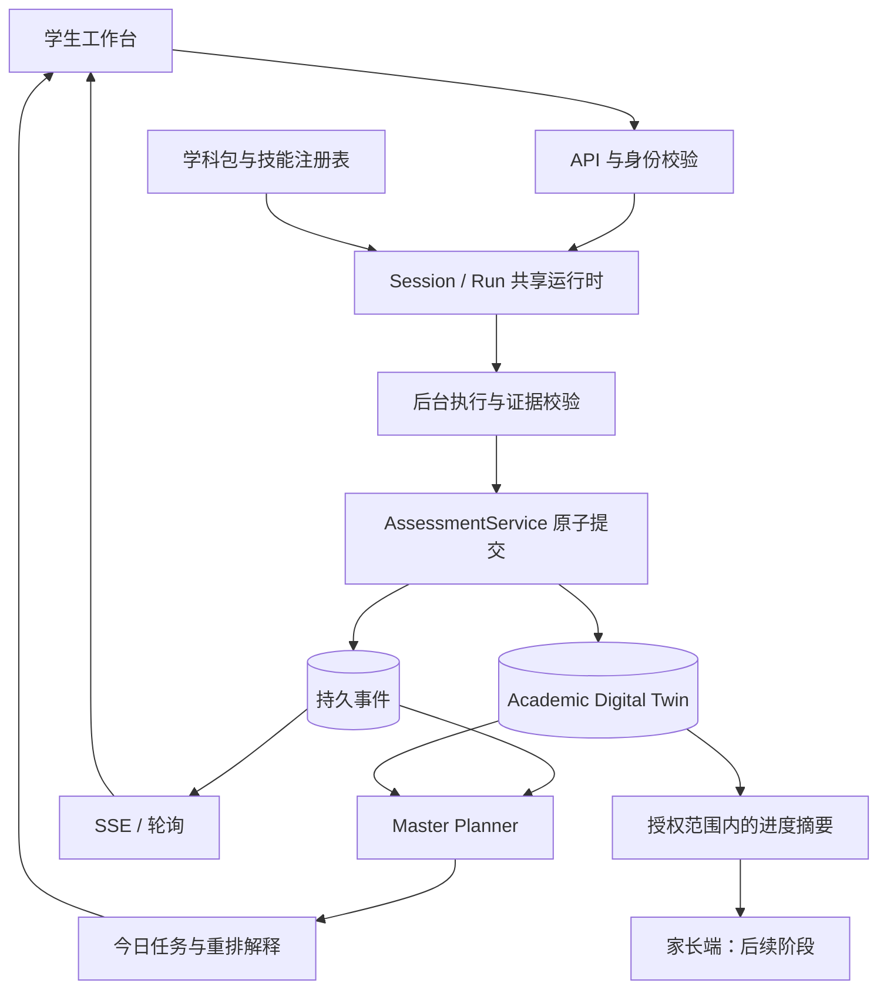

# 高中学业全周期 AI 智能体 — 产品与架构方案 v0.3

更新：2026-10-29。本文采纳 [架构建议](STUDENT_OS_ARCHITECTURE_RECOMMENDATIONS.md)，替代旧版中 Task 与 Session 合并、客户端加预测分、依赖参考产品登录和首发五门 AP 的设计。这里描述目标方案，不表示功能已经实现。

产品面向美国高中生，长期覆盖 **AP 学习、Digital SAT 备考、大学申请**。首个试点服务正在学 Calculus BC、同时准备 SAT 的 10–11 年级学生。核心闭环是：**学习证据 → 学生记录 → 下一项学习任务 → 更新周计划**。

## 1. 产品价值与首个验证目标

学生完成一次练习后，应得到可核对的反馈、值得做的下一项任务，以及任务为何进入日程的解释。跨域推荐必须由证据支持，不能仅因某课程答错就推断另一门考试也存在相同弱点。

首个完整切片：

> Calculus 练习 → 服务端按 rubric 评估 → 保存证据与进度 → 对可能的共享前置技能做 SAT 短诊断 → 仅在诊断支持时安排补强 → 在学生可用时间内更新计划。

试点不以科目数量、聊天轮数或预测分上涨作为成功指标。验证学生能否理解反馈、完成合适的后续练习、在无提示的新题上表现改善，并愿意回到系统继续学习。商业假设见 [COMPETITIVE_REVIEW.md](COMPETITIVE_REVIEW.md)。

## 2. 架构：共享运行时 + 学生记录 + Planner

| 模块 | 职责 |
|---|---|
| Academic Digital Twin | 学生身份、目标、日历、学习记录与成果的统一逻辑视图；底层分文档存储 |
| Master Planner | 根据截止日期、经评估的技能需求、时间预算和学生偏好产出具体任务 |
| AP_BASE / DSAT / ADMISSIONS | 三类配置，复用一个运行时；不要求三个微服务或自治 Agent 相互聊天 |
| SubjectPackRegistry | 装载课程、rubric、技能、检索范围、工具白名单和版本 |
| Session / Run Manager | 保存会话与每次执行；支持刷新恢复、取消、等待补充输入 |
| AssessmentService | 验证评估结果，统一提交证据与学习进度；科目包不直接改学生记录 |

基础技术：Python 3.12+、FastAPI、Pydantic v2、mypy、Firestore、Cloud Tasks、Cloud Scheduler、Cloud Storage、Cloud Run。模型调用经 `LLMGateway`。本地使用 Firebase Auth/Firestore emulator 与队列适配器；JSON 仅作演示/测试夹具。详细设计见 [BACKEND.md](BACKEND.md)。

只参考通用 agent、session、tool、event 概念，独立实现 Student OS。**不使用 LOGIQ 代码、凭证、服务器或内部 API；不以兼容 Anthropic Managed Agents API 作为产品目标。**

## 3. 学生记录：事实、评估、估计分别保存

Student OS 拥有独立身份与数据库。内部连接键为稳定 `studentId`，由已验证身份映射得到；email 仅是联系方式或未来外部映射字段。参考项目移走后仍能独立构建、登录、测试和运行。

| 记录 | 内容与来源 |
|---|---|
| Profile / Goals | 年级、学校、兴趣、目标、在修课程；学生可编辑字段有明确白名单 |
| Preferences / Timeline | 时区、每周可用小时、提醒偏好、考试/学校日程；保留日期来源与确认状态 |
| Entitlements | 后端控制的访问权限，与学生自行选择的课程分开 |
| Submissions / Assessments | 原始作答、题目版本、rubric、提示使用情况、评分证据与评估状态 |
| Mastery | 从评估证据派生的技能掌握度、覆盖度、样本量与不确定性 |
| Exam Records / Predictions | 自报/已验证成绩与系统预测分开；预测需要独立校准后才可展示 |
| Artifacts | 作答文件、反馈、大纲、学生草稿、活动描述、选校说明的版本与访问范围 |

一次订正不直接换算成 AP 分数增长。首版显示 rubric 反馈、已观察到的技能表现、提示依赖和证据不足；考试预测保持 `unavailable`。BKT 可以作为后续掌握度估计方法，但不天然输出可靠的 AP 1–5 或 SAT 1600 分预测。

每份 Assessment 至少记录 submission、question/rubric/workflow/model 版本、反馈依据、工具核验结果、提示记录与评估不确定性。模型声称“高置信”本身不算经过校准的置信度。

## 4. Task、Session、Run 的职责

| 实体 | 含义 | 生命周期 |
|---|---|---|
| Task | Planner 建议完成的学习目标，可有多次尝试 | `PLANNED → IN_PROGRESS → COMPLETED`，或 `SKIPPED` |
| Session | 学生围绕任务持续进行的对话、作答和文件集合 | `OPEN → COMPLETED / ABANDONED` |
| Run | 一次后台执行，如批改一次提交或生成一次提示 | `QUEUED → RUNNING → SUCCEEDED / FAILED / CANCELLED`，可等待 `WAITING_INPUT` |

一个 Session 可包含多次 Run；一个 Task 可有多次 Session 尝试。后台 Run 完成不等于学生完成整个 Task。服务端在学生请求完成且满足任务条件后关闭 Session；评估提交与最终完成均有各自的事务和幂等键，不会重复累计进度。

例如：学生离开页面时批改仍继续；第二天回来可查看结果；再次订正创建新的 Submission/Run，保留之前的作答，而不是覆盖旧证据。接口见 [API.md](API.md)。

## 5. 跨域上下文：先提出诊断，再验证映射

所有领域事件由后端生成并持久化。客户端只提交命令与作答，不能伪造掌握度、工具成功或评估完成事件。

| 事件 | 消费者与效果 | 证据要求 |
|---|---|---|
| `assessment.completed` | 更新学习记录；评估跨域前置技能候选 | 有效 rubric、作答与可追溯 evidence |
| `mastery.updated` | Planner 重新考虑技能补强优先级 | 保留样本量、提示依赖和不确定性 |
| `prerequisite.suspected` | 推荐一个小型 SAT 诊断 | 经内容审核的映射版本，不等同已确认弱点 |
| `prerequisite.confirmed` | 安排针对性 SAT 练习 | 独立诊断支持；否则记录无支持/证据不足 |
| `vocab.context` | 后续阶段生成语境闪卡 | 材料权限、原句来源、课程与学生范围 |
| `calendar.pressure` | 调整未来未开始任务 | 真实日程、学生时间预算和偏好 |
| `plan.updated` | 向学生解释新任务和改期原因 | 来源事件、变更范围和时间预算 |
| `profile.evidence_updated` | 后续提示选校资料需要复核 | 区分正式成绩、自报成绩、练习评估和预测 |
| `narrative.gap` | 后续生成学生可选择的探索任务 | 学生确认的兴趣与经历，不虚构活动 |

隐函数求导漏项可能只是微积分知识问题。只有明确涉及共享前置技能的证据才提出对应 SAT 诊断；未获支持时不生成自动补强任务。领域消费者按来源事件和目标技能去重。

内部 AP 估计不自动改写 Reach / Match / Safety。未来选校建议应根据有来源的学生事实和学校数据重新评估，并展示限制与依据。

## 6. Master Planner：可解释且尊重时间预算

v1 使用规则，模型可帮助解释或拆解任务，但不自行设定学术事实或修改权限。

1. 根据近期截止、必要前置技能、评估证据、覆盖度与学生目标确定候选任务。
2. 在当地日期和每周可用小时内排程；证据不足时优先短诊断。
3. 学生可以延后、跳过或锁定安排；增量重排保留进行中与已完成任务。
4. 校内考试周减少其他负荷，具体比例可配置并向学生解释。
5. 每日调度和学习结果更新都调用同一 Planner；重复触发不产生重复任务。

“投入产出”首版表示时间与已知学习目标的取舍，不量化某项活动带来的录取收益。未知考试日期不由模型补造；申请截止需引用学校官方来源并记录核验时间。

| 年级 | 长期默认重心 |
|---|---|
| 9 | 学习习惯、课程探索与基础技能 |
| 10 | 课程负荷、SAT 基础与兴趣探索 |
| 11 | SAT/AP 时间协调、选校资料与文书准备 |
| 12 | 申请材料与截止安排 |

提醒以学生同意的渠道、当地时区、安静时段和频次上限发送。不能把未完成任务默认转成家长警报。

## 7. 三类 Agent 与内容包

### AP Base

首个可执行课程包为 `calc_bc`。APUSH、Physics C、CSA、AP Lang 保留在后续目录中，未达到内容/工具/评估门槛时状态为 `planned`，不能开真实 Session。新课程复用运行时，但新题型、工具或画布仍可能需要工程改动，不能承诺只改 manifest 就覆盖所有科目。

共用能力包括课程权限校验、作答版本、`GPA_SYNC` 苏格拉底模式、`EXAM_CRUNCH` 限时练习模式、证据提交和恢复。考试临近可建议切换模式，学生选择优先。

| Skill 家族 | 首发与后续用途 |
|---|---|
| 苏格拉底追问 | 首发；指导下一步并记录提示依赖 |
| STEM rubric 评估 | 首发 Calculus；按题目版本核验推导、答案与单位 |
| OCR / LaTeX | 文字输入闭环后加入；无法确认的识别先让学生核对 |
| DBQ / 修辞写作反馈 | M5 扩展；按科目和 rubric 版本评价 |
| Java 代码评估 | M5 扩展；课程评分规则与代码沙箱分别实现 |
| SAT 短诊断 / 补强 | M3；人工审核题与映射优先 |
| 语境词汇 | M5 扩展；绑定材料来源与权限 |

检索内容分为课程公共结构和学生私有材料。课程、studentId 与文件 ACL 是服务端约束，不仅依赖 namespace 命名。原始作答/文书不进入通用日志。材料保留来源与使用权限；不构建 College Board 官方真题全文库。

工具先通过内部接口接入，如检索、OCR、数学核验。MCP 是可选适配层；Desmos 的交互/API 可用性需独立验证，不能把 stub 当作已运行工具展示。

### Digital SAT

试点只做与 Calculus 共享前置技能相关的诊断和练习。长期支持 Reading & Writing、Math、模块自适应练习、错因图谱与语境词汇。

题目用原创或获授权材料。两阶段模块训练不代表复现官方评分算法；无校准的短诊断只报告技能结果，不输出官方式 SAT 分数。

### Admissions and Essay

放在核心学习闭环之后：基于学生确认的经历做访谈、主线探索、大纲、反馈与活动列表修订。学生自己写正文，事实改写需确认。学校资料、截止、费用等有独立来源和更新时间，不能从模型记忆直接当事实保存。

基础画像可先收集，自动选校分档、补充文书工作台、奖学金/净价、模拟委员会与顾问协作均属于 M5 后续扩展。

## 8. 实施路线与验收

统一使用 M0–M5，详见 [IMPLEMENTATION_PLAN.md](IMPLEMENTATION_PLAN.md) 和 [STEP_BY_STEP_PLAN.md](STEP_BY_STEP_PLAN.md)。旧 Phase 编号与旧 M4 Jev 排期不再适用。

| 里程碑 | 结果 |
|---|---|
| M0 契约与基线 | 新 schema、两名合成学生、题目与映射评估夹具 |
| M1 可靠基础 | 独立登录、隔离、持久 Task/Session/Run、队列与幂等，内部端到端演示 |
| M2 Calculus 学习闭环 | 真实反馈、证据评估、原子回写、SSE/轮询恢复 |
| M3 SAT 跨域验证 | 候选前置技能 → 短诊断 → 有证据的补强 |
| M4 主动规划与试点 | 时区调度、学生控制、提醒、部署与外部试点质量门槛 |
| M5 覆盖扩展 | APUSH 优先，其余课程/申请/家长功能按证据排序 |

首发验收覆盖：评估与人工 rubric 一致性、独立题表现、跨域推荐恰当性、计划可理解性；同时验证重启恢复、重复投递、无重复进度、跨学生访问拒绝。考试预测校准是后续独立轨道。

## 9. 产品边界

- 家长角色只访问明确授权的进度摘要；默认不开放完整对话、原始作答和文书草稿。撤销授权要立即影响后续访问。
- 学生课程偏好不授予访问权限；entitlements 仅由后台管理。
- 文书能力为访谈、大纲和反馈，不提供一键代写正文。
- 不承诺录取结果，也不把模型输出当成正式成绩。
- `ai-college-advisor`、`sat-tutor-app` 仅作只读参考；外部互通是未来单独的 API 契约，不共享 JWT 密钥、数据库或本地运行依赖。
- Jev、MCP、Temporal 属于可选后续评估，不阻塞 M0–M4。技术面试不在范围内。
